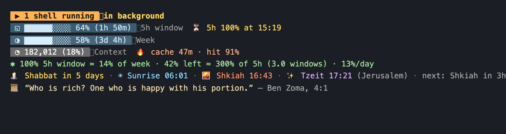

# agent-statusline

A status line for **Claude Code** that you configure with arrows and space — no JSON editing.
Zero dependencies, Node ≥ 18. **Codex** support is next.



## Install

You need [Node.js](https://nodejs.org) 18 or newer.

```bash
npm i -g github:yair-roshal/agent-statusline   # 1. download
agent-statusline install                       # 2. connect to Claude Code (backs up ~/.claude/settings.json)
agent-statusline                               # 3. pick what to show
```

The new status line shows up on the next redraw — no restart needed.
For the arrows in the cells, use a terminal font with Powerline glyphs (any Nerd Font, MesloLGS, JetBrains Mono NL…).

Update: run the first command again. `agent-statusline uninstall` puts your previous status line back.

## Picking segments

Run `agent-statusline` and you get one screen:

| key | action |
| --- | --- |
| `↑` `↓` | move |
| `space` | show / hide |
| `→` `←` | move to the next / previous line |
| `[` `]` | reorder within a line |
| `p` | cycle presets |
| `s` | style: `cells` (default), `plain`, `powerline`, `capsule` |
| `t` | theme: `default`, `nord`, `sunset`, `mono` |
| `g` | language: `en`, `ru` |
| `i` | icons on/off |
| `enter` | save and exit |

The preview at the bottom uses your last real session data, so you see exactly what you'll get.

Prefer one-liners (or want Claude to change it for you)?

```bash
agent-statusline preset limits
agent-statusline add zmanim 4
agent-statusline remove cost
agent-statusline set style powerline
agent-statusline set city "New York"
agent-statusline list
```

## Segments

**Session** — `model` (with effort, 🧠 thinking, ⚡ fast mode) · `dir` · `git` (branch, changed files, ahead/behind) · `session` · `version` · `clock`

**Usage**
- `context` — bar, %, tokens used / window size
- `limit5h`, `limitWeek` — bar, %, time until reset
- `forecast5h`, `forecastWeek` — at the pace since the window started, *when* you hit 100% (or ✓ "lasts till reset")
- `windowsLeft` — how many full 5-hour windows fit in what's left of the weekly limit, and the daily budget until the weekly reset. Tune `windowWeeklyPct` (default 14 — one full 5h window ≈ 14% of the week on a Max plan; measure your own).
- `cost` — session cost and $/hour
- `duration` — session length and share of time spent waiting on the API
- `lines` — lines added / removed
- `cache` — prompt cache: warm or ❄ cold, minutes until it expires, hit rate. Know whether a coffee break will cost you a full re-cache.

**Extras**
- `zmanim` — days to Shabbat (candle-lighting time on Friday), sunrise, shkiah, tzeit hakochavim, and countdown to the next one. Computed locally, no network. `set city Jerusalem` or any of the built-in cities, or your own `{ "name", "lat", "lon", "tz", "candles" }`.
- `quote` — one quote a day: `avot` (Pirkei Avot), `dev`, `stoic`, or `quotesFile` with `[["text","author"], …]`
- `breathe` — after `breakEvery` minutes (default 90) reminds you to stand up
- `text` — any static text
- `command` — first line of any shell command, cached 30 s (`set command "kubectl config current-context"`)

## Presets

`minimal` · `default` · `limits` · `full` · `zmanim`

## Config

`~/.config/agent-statusline/config.json` (override with `AGENT_STATUSLINE_CONFIG`):

```json
{
  "style": "plain",
  "theme": "default",
  "lines": [["model", "dir", "git"], ["context", "limit5h", "forecast5h"]],
  "options": { "lang": "en", "barWidth": 10, "barStyle": "blocks", "city": "Jerusalem" }
}
```

`barStyle`: `blocks ▰▱` · `line ━─` · `dots ●○` · `shade █░`. `NO_COLOR=1` disables colors.
`powerline` and `capsule` styles need a [Nerd Font](https://www.nerdfonts.com/).

## Roadmap

- [x] Claude Code
- [ ] Codex — the adapter layer (`src/adapters/`) normalizes each agent's data into one model, so every segment works for both
- [ ] npm release

## Adding a segment

Segments live in `src/segments/index.js`. Each one is:

```js
def({
  id: 'hello', group: 'extras',
  desc: { en: 'Says hello' },
  render: (d, c) => ({ icon: '👋', text: `hello ${d.model?.name}`, level: 'ok' }), // or null to hide
});
```

`npm test` runs every preset × style × theme against demo data.

## License

MIT
